# Analog Clock for React

[](https://www.npmjs.com/package/@studiotoolkit/analog-clock)
[](https://www.npmjs.com/package/@studiotoolkit/analog-clock)
[](https://bundlephobia.com/package/@studiotoolkit/analog-clock)
[](https://www.npmjs.com/package/@studiotoolkit/analog-clock)
[](./LICENSE)
[](https://studiotoolkit.github.io/build-clock)

A live **analog clock React component**, drawn in SVG. It shows any IANA time zone and comes with 12 watch faces, light and dark themes, 7 second-hand motions and an optional digital readout. It works with server rendering, is written in TypeScript and needs nothing besides React.

**Live demo:** [https://studiotoolkit.github.io/build-clock](https://studiotoolkit.github.io/build-clock). Try every face, colour and dial option, then copy the generated code.

<p align="center">
  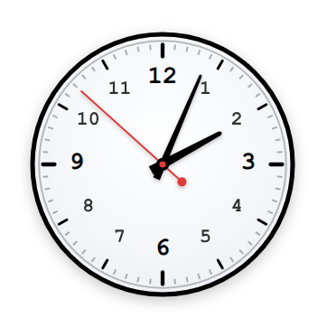
  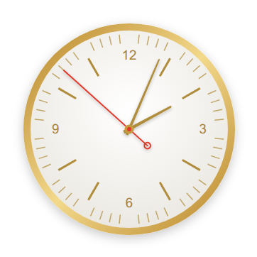
  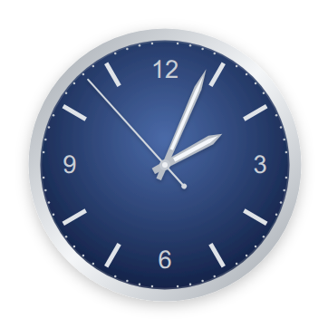
  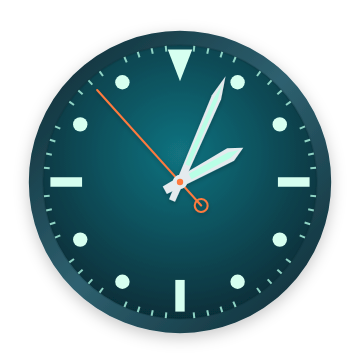
</p>

## Features

- **Any time zone.** Pass an IANA zone such as `"Asia/Tokyo"` and build a world clock in a few lines.
- **12 watch faces**, from a plain wall clock to dress, dive and chronograph styles. You can restyle any face with CSS variables.
- **Customisable dial.** Choose Arabic or Roman numerals, 8 marker shapes and 5 minute-tick styles.
- **7 second-hand motions:** tick, smooth, sweep, stop-to-go (like a railway clock), bounce, ease and anticipate.
- **Light and dark themes**, plus an optional 12h or 24h digital readout.
- **SSR-safe.** There are no hydration errors in Next.js, Remix and similar frameworks.
- **Accessible.** The clock has `role="img"` and a live `aria-label`, and it respects `prefers-reduced-motion`.
- **Light.** There are no runtime dependencies, no CSS import is needed, and the clock works with React 18 and 19.

## Installation

```bash
npm install @studiotoolkit/analog-clock
# or
pnpm add @studiotoolkit/analog-clock
# or
yarn add @studiotoolkit/analog-clock
```

## Quick start

```tsx
import { Clock } from '@studiotoolkit/analog-clock';

export default function App() {
  return <Clock />;
}
```

This shows the user's local time with the default face. You don't need to import any CSS.

## Examples

### World clock

```tsx
import { Clock } from '@studiotoolkit/analog-clock';

const cities = [
  { label: 'New York', timezone: 'America/New_York' },
  { label: 'London', timezone: 'Europe/London' },
  { label: 'Tokyo', timezone: 'Asia/Tokyo' },
];

export function WorldClock() {
  return (
    <div style={{ display: 'flex', gap: 24 }}>
      {cities.map((c) => (
        <Clock key={c.timezone} label={c.label} timezone={c.timezone} radius={80} />
      ))}
    </div>
  );
}
```

### Faces, themes and colours

```tsx
<Clock label="Tokyo" timezone="Asia/Tokyo" theme="dark" radius={80} />
<Clock label="Geneva" timezone="Europe/Zurich" face="gold" />
<Clock
  label="Paris"
  timezone="Europe/Paris"
  timeFormat="24h"
  hourHandColor="#2e7d32"
  minuteHandColor="#ef6c00"
  secondHandColor="#d81b60"
/>
```

### Second hand motion

```tsx
<Clock secondHandMotion="sweep" />       {/* like an automatic watch */}
<Clock secondHandMotion="stop-to-go" />  {/* like a railway station clock */}
```

## Props

Every prop is optional.

| Prop          | Type                  | Default        | Description                                                     |
| ------------- | --------------------- | -------------- | --------------------------------------------------------------- |
| `radius`      | `number`              | `100`          | Dial radius in pixels. The SVG is `radius * 2 + 36` px square.  |
| `label`       | `string`              | `""`           | Text on the dial, shown in uppercase. Hidden when `radius < 50`. |
| `timezone`    | `string \| null`      | `null`         | IANA zone such as `"America/New_York"`. Local time is used when it is unset or invalid. |
| `face`        | `ClockFace`           | `"default"`    | Watch face. See [Watch faces](#watch-faces).                    |
| `theme`       | `"light" \| "dark"`   | `"light"`      | Dial colour scheme.                                             |
| `showSeconds` | `boolean`             | `true`         | Show the second hand, and seconds in the digital readout.       |
| `showDigital` | `boolean`             | `true`         | Show the digital time below the dial.                           |
| `timeFormat`  | `"12h" \| "24h"`      | `"12h"`        | Digital time as `hh:mm:ss AM` or `HH:mm:ss`.                    |
| `secondHandMotion` | `SecondHandMotion` | `"tick"`     | How the second hand moves. See [Second hand motion](#second-hand-motion). |
| `secondHandStyle` | `SecondHandStyle` | `"face"`       | How the second hand looks. See [Second hand style](#second-hand-style). |
| `secondHandMarkerAt` | `number`      | `100`          | Where the object sits on the second hand, from 0 (inner end) to 100 (tip). |
| `numbers`     | `DialNumbers`         | face           | Which hours get a number. See [Dial](#dial).                    |
| `numerals`    | `DialNumerals`        | face           | `"arabic"`, `"roman"` (IV) or `"roman-iiii"` (IIII).            |
| `rotateNumbers` | `boolean`           | face           | Turn each number so its top faces the edge.                     |
| `mainMarker`  | `DialMarker`          | face           | Markers at 12, 3, 6 and 9.                                      |
| `marker12`    | `DialMarker`          | `mainMarker`   | Marker at 12 only.                                              |
| `hourMarker`  | `DialMarker`          | `mainMarker`   | Markers at the other 8 hours.                                   |
| `minuteTicks` | `DialMinuteTicks`     | face           | Minute ticks.                                                   |
| `hideMarkersAtNumbers` | `boolean`    | face           | Leave out the marker wherever a number is drawn.                |
| `borderColor` | `string`              | face colour    | Bezel colour.                                                   |
| `dialColor`   | `string`              | face colour    | Dial colour. The edge is shaded slightly darker for depth.      |
| `tickColor`   | `string`              | face colour    | Tick marks. Minute ticks are drawn lighter.                     |
| `numberColor` | `string`              | face colour    | The 1–12 numbers.                                               |
| `hourHandColor`   | `string`          | face colour    | Hour hand and centre cap.                                       |
| `minuteHandColor` | `string`          | face colour    | Minute hand.                                                    |
| `secondHandColor` | `string`          | face colour    | Second hand and centre dot.                                     |
| `digitalColor`    | `string`          | face colour    | Digital time text.                                              |

Colour props always win over the face. You can start from a face and change just the second hand, for example.

Every prop, with its type, default, description and allowed values, is also listed in [`configuration.json`](./configuration.json), which ships with the package. This is useful for building settings panels or docs:

```ts
import config from '@studiotoolkit/analog-clock/configuration.json';
```

## Watch faces

<table>
<tr>
<td align="center"><br/><code>default</code></td>
<td align="center"><br/><code>gold</code></td>
<td align="center">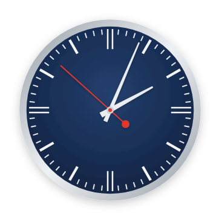<br/><code>blue</code></td>
<td align="center">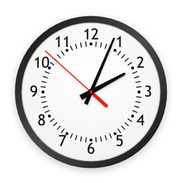<br/><code>wall-black</code></td>
</tr>
<tr>
<td align="center">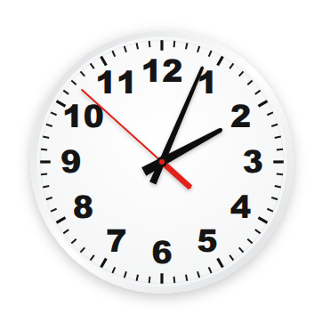<br/><code>wall-white</code></td>
<td align="center">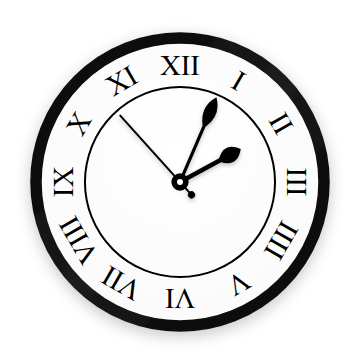<br/><code>roman</code></td>
<td align="center">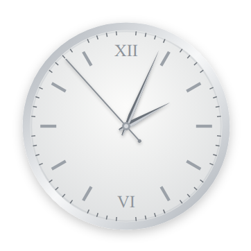<br/><code>steel</code></td>
<td align="center"><br/><code>navy</code></td>
</tr>
<tr>
<td align="center">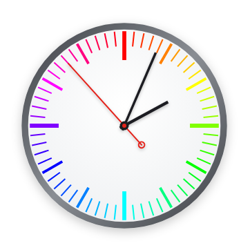<br/><code>spectrum</code></td>
<td align="center">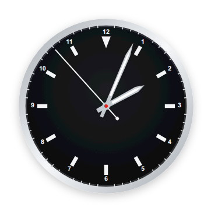<br/><code>chrono</code></td>
<td align="center"><br/><code>ocean</code></td>
<td align="center">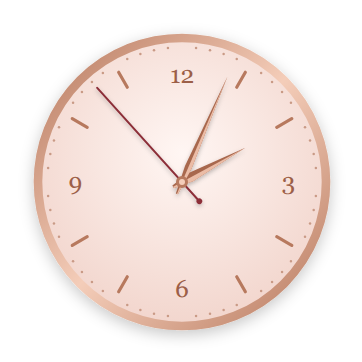<br/><code>blush</code></td>
</tr>
</table>

| Face      | Look                                                                 |
| --------- | -------------------------------------------------------------------- |
| `default` | The original clock: black and white (or slate in dark mode), with all 12 numbers. |
| `gold`    | Polished gold case, white dial, thin gold hour sticks, numbers at 12/3/6/9, slim gold hands. |
| `blue`    | Brushed steel case, navy dial, slim white markers with double lines at 12/3/6/9, pointed white hands, no numbers. |
| `wall-black` | Black wall-clock case, numbers around the edge, a tick ring inside them with hour dots, red second hand with a bar tail. |
| `wall-white` | Slim white case, heavy black numbers, ticks around the outer edge, red second hand with a bar tail. |
| `roman`   | Thick black case, Roman numerals facing outward in a ringed band, black spade hands, no ticks. |
| `steel`   | Polished steel case, silver dial, upright Roman XII and VI, applied batons, slim faceted dauphine hands. |
| `navy`    | Polished steel case, blue dial darkening to the edge, numbers at 12/3/6/9, batons, sword hands with a bright stripe. |
| `spectrum` | Gunmetal case, white dial, ticks in colour-wheel colours (red at 12, then clockwise through yellow, green, cyan, blue and magenta), bold lines at the quarters, near-black hands. |
| `chrono`  | Steel case, black dial, minute track, small numbers, white batons, a triangle at 12, sword hands with a bright stripe. |
| `ocean`   | Dive style: thick dark-teal case, deep teal dial, large mint dots for the hours, bars at 3/6/9, triangle at 12, mint-striped sword hands, orange second hand. |
| `blush`   | Dress style: rose-gold case, blush-pink dial, serif numbers at 12/3/6/9, slim rose-gold markers, dotted minutes, faceted lance hands, burgundy second hand. |

`CLOCK_FACES` lists the faces as `[{ id, label }]`, which is handy for a picker.

### Styling

**No CSS import is needed.** The first clock on a page adds the face styles to `<head>` once. They go first in `<head>`, so your own CSS still overrides them.

The same styles are also published as `style.css`. Import it instead if your site's Content Security Policy blocks inline `<style>` tags, or if you want the colours in place before any JavaScript runs:

```tsx
import '@studiotoolkit/analog-clock/style.css'; // optional
```

To restyle a face, override its CSS variables:

```css
.analog-clock--blue {
  --ac-face-inner: #1f5133;
  --ac-face-outer: #0e2a1a; /* now a green dial */
}
```

| Variable | Used for |
| --- | --- |
| `--ac-bezel`, `--ac-bezel-2` | Case colour (two stops for a metallic sheen) |
| `--ac-face-inner`, `--ac-face-outer` | Dial gradient |
| `--ac-tick`, `--ac-minor-tick` | Hour and minute marks |
| `--ac-number`, `--ac-number-font`, `--ac-number-weight` | Dial numbers |
| `--ac-label`, `--ac-label-font`, `--ac-label-weight` | Label text |
| `--ac-hour-hand`, `--ac-minute-hand`, `--ac-second-hand` | Hands |
| `--ac-hand-shine` | Lighter half of faceted hands |
| `--ac-hand-inlay` | Stripe down the middle of inlaid hands |
| `--ac-ring` | Rings drawn on the dial (defaults to the tick colour) |
| `--ac-tick-hue`, `--ac-tick-hue-step`, `--ac-tick-sat`, `--ac-tick-light` | Spectrum ticks: hue at 12 o'clock, degrees per minute, saturation, lightness |
| `--ac-cap`, `--ac-cap-dot` | Centre cap (defaults to the hour and second hand colours) |
| `--ac-digital`, `--ac-digital-font` | Digital time |

## Dial

Every watch face has its own numbers and markers. These props change them, and anything you leave out keeps the face's design.

| Prop          | Values |
| ------------- | ------ |
| `numbers`     | `"all"`, `"quarters"` (12, 3, 6, 9), `"12"`, `"12-6"`, `"none"` |
| `numerals`    | `"arabic"` (1, 2, 3), `"roman"` (I, II, IV), `"roman-iiii"` (I, II, IIII, the clockmaker style) |
| `mainMarker`, `marker12`, `hourMarker` | `"bar"`, `"line"`, `"double"`, `"dot"`, `"square"`, `"triangle-in"`, `"triangle-out"`, `"diamond"`, `"none"` |
| `minuteTicks` | `"line"`, `"short"`, `"dot"`, `"railway"` (ticks between two thin rings), `"rainbow"` (coloured by position), `"none"` |

`marker12` and `hourMarker` default to `mainMarker`, so a triangle at 12 with bars elsewhere is:

```tsx
<Clock mainMarker="bar" marker12="triangle-out" />
<Clock numbers="quarters" numerals="roman" minuteTicks="railway" />
```

New markers start where the face's own markers start. They shrink, or move out to the minute track, when they would touch the numbers. When you add numbers to a face whose markers run through the same ring (like `gold`), the markers under the numbers are hidden unless you set `hideMarkersAtNumbers={false}`.

`DIAL_NUMBERS`, `DIAL_NUMERALS`, `DIAL_MARKERS` and `DIAL_MINUTE_TICKS` list the values as `[{ id, label }]` for pickers.

## Second hand motion

| Motion       | Movement                                                                 |
| ------------ | ------------------------------------------------------------------------ |
| `tick`       | One jump per second (the default).                                       |
| `smooth`     | Glides continuously, updated every frame.                                |
| `sweep`      | 8 small steps per second, like an automatic watch.                       |
| `stop-to-go` | One lap in 58 s, a 2 s pause at 12, then the minute hand jumps, like a railway clock. The minute hand only moves on the minute. |
| `bounce`     | Springs to each second, overshoots and wobbles before settling.          |
| `ease`       | A soft ease-in-out move to each second.                                  |
| `anticipate` | Dips back slightly, then snaps forward.                                  |

Every motion except `tick` uses `requestAnimationFrame`. Only the second hand's transform changes each frame, and the component still re-renders once a second. `bounce`, `ease` and `anticipate` are timed so the hand reaches each mark exactly when the second changes, in step with the digital time.

When the user's system asks for reduced motion (`prefers-reduced-motion: reduce`), `bounce`, `ease` and `anticipate` fall back to `tick`. `smooth`, `sweep` and `stop-to-go` don't wobble, so they stay as chosen. In a hidden browser tab the hand pauses with the page, but the digital time and `aria-label` keep updating.

`SECOND_HAND_MOTIONS` lists the motions as `[{ id, label }]` for a picker, and `secondHandAngle(motion, seconds, ms)` returns the angle in degrees.

## Second hand style

`secondHandStyle` picks the hand, and `secondHandMarkerAt` places an object on it.

| Style     | Look                                         |
| --------- | -------------------------------------------- |
| `face`    | The watch face's own hand (the default).     |
| `plain`   | A simple line.                               |
| `tapered` | Widest at the tail, narrowing to a fine tip. |
| `<shape>-<fill>` | A thin line with an object on it. Shape: `circle`, `rect`, `half-circle` (dome toward the tip) or `triangle` (points toward the tip). Fill: `filled` or `outline`. |

Every style except `face` is drawn in the second-hand colour, without the face's counterweight.

`secondHandMarkerAt` goes from 0 to 100 and defaults to `100`. At `0` the object is flush with the inner end of the hand (the short tail past the centre), and at `100` it is flush with the tip. Values outside 0–100 are clamped. The hand always runs its full length, so an object placed mid-hand sits on the line.

```tsx
<Clock secondHandStyle="circle-filled" />                            {/* dot at the tip */}
<Clock secondHandStyle="triangle-outline" secondHandMarkerAt={0} />  {/* at the inner end */}
<Clock secondHandStyle="circle-outline" secondHandMarkerAt={90} />
```

`SECOND_HAND_STYLES` lists every style as `[{ id, label, group }]` for a picker. `group` is `"Hand"` or `"Object"`, for use in `<optgroup>`s.

## Helpers

`Clock` is also exported as `AnalogClock`. The prop and value types are exported too: `ClockProps`, `ClockFace`, `ClockTheme`, `TimeFormat`, `SecondHandMotion`, `SecondHandStyle`, `SecondHandMarker`, `SecondHandFill`, `DialNumbers`, `DialNumerals`, `DialMarker` and `DialMinuteTicks`.

```ts
import { getTimeInZone, formatDigitalTime } from '@studiotoolkit/analog-clock';

getTimeInZone('Asia/Kolkata');                                           // e.g. { hours: 15, minutes: 45, seconds: 30 }
formatDigitalTime({ hours: 15, minutes: 45, seconds: 30 });              // "03:45:30 PM"
formatDigitalTime({ hours: 15, minutes: 45, seconds: 30 }, true, '24h'); // "15:45:30"
```

## Server rendering (Next.js, Remix)

The clock works with server rendering. On the server, and on the browser's first render, it draws the dial without hands or time, so both renders match and React reports no hydration error. The hands and time appear as soon as the component mounts. A hidden placeholder keeps the digital time's space, so nothing shifts.

## Accessibility

The SVG has `role="img"` and an `aria-label` with the label and current time, for example `"London: 10:15:30 AM"`. Before the time is known, it reads `"London: Clock"`.

## Contributing: adding a face

1. In `src/faces.ts`, add the id to `ClockFace` and `CLOCK_FACES`, and add its shapes to `FACE_GEOMETRY`:
   - **Numbers:** `numbers` is `"all"`, `"quarters"`, `"none"` or a list of hours like `[12, 6]`. `numerals` is `"arabic"` or `"roman"`. `rotateNumbers` turns the numbers to face the bezel. `hideMarksAtNumbers` drops the hour mark under each number.
   - **Marks:** `quarterMark`, `hourMark` and `minuteMark` take a `shape` of `line`, `double`, `dot`, `square`, `triangle` or `diamond`, or `null` for none. `markOverrides` swaps the mark at given hours, e.g. `{ 12: triangle }`. `spectrumTicks: true` colours marks by position.
   - **Hands:** `shape` is `taper`, `bar`, `spade`, `dauphine` or `sword`. Add `facet: true` for a two-tone ridge or `inlay: true` for a centre stripe. The second hand's tail is a `filled` or `ring` circle, or a `bar`.
2. Add `src/faces/<id>.css` with the `--ac-*` variables under `.analog-clock--<id>`.
3. Rebuild. Every file in `src/faces/` is included in both the built-in styles and `style.css`.

`FACE_GEOMETRY` is internal and not exported, so face shapes can change in any release without breaking apps that use the clock.

Issues and pull requests are welcome on [GitHub](https://github.com/studiotoolkit/studiotoolkit/issues).

## License

[MIT](./LICENSE)