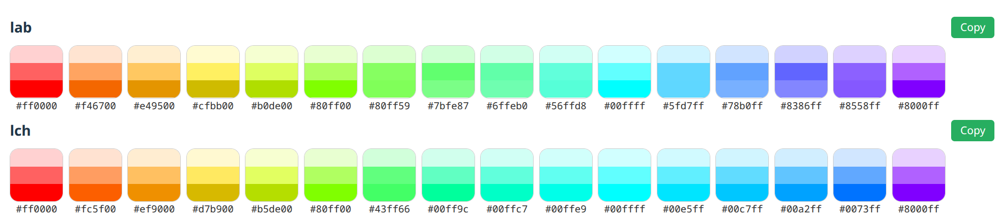
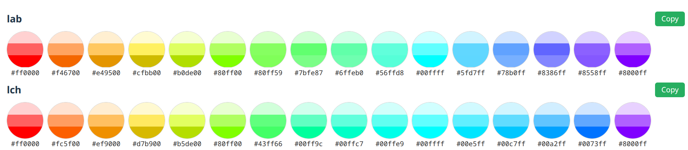
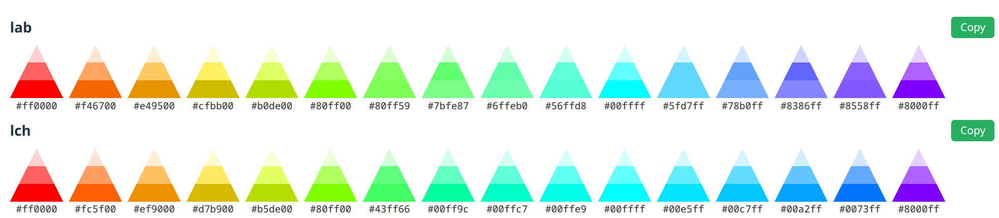
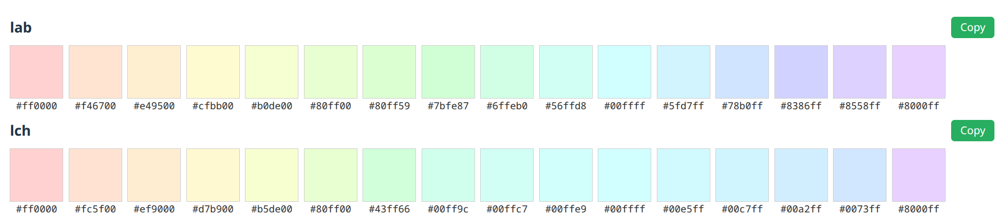
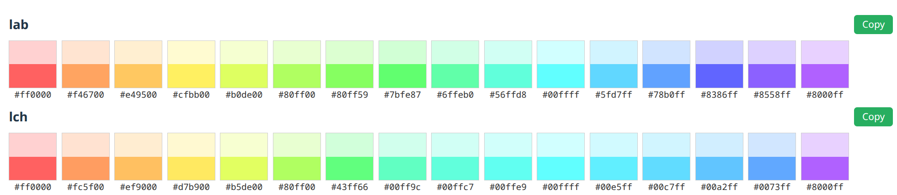

# Color Palette for React

[](https://www.npmjs.com/package/@studiotoolkit/color-palette)
[](https://www.npmjs.com/package/@studiotoolkit/color-palette)
[](https://bundlephobia.com/package/@studiotoolkit/color-palette)
[](https://www.npmjs.com/package/@studiotoolkit/color-palette)
[](./LICENSE)
[](https://studiotoolkit.github.io/build-color-palette)

A **React component for showing colour palettes**. Pass it named lists of hex colours and it draws them as blocks, squares, circles, triangles or a table, with optional hex codes and a copy button. Each swatch can be split into two or three tinted bands. It is written in TypeScript and needs nothing besides React.

**Live demo:** [https://studiotoolkit.github.io/build-color-palette](https://studiotoolkit.github.io/build-color-palette). Try every option, then copy the generated code.

**All components together:** [https://studiotoolkit.github.io/demo-all](https://studiotoolkit.github.io/demo-all)

<p align="center">
  
</p>

## Features

- **5 display types:** `block`, `square`, `circle`, `triangle` and `table`.
- **Multi-band swatches.** Split each swatch into 1, 2 or 3 bands, each with its own saturation and brightness.
- **Copy to clipboard.** An optional button per palette copies its colours.
- **Styling props** for size, borders, title, font and background.
- **Light.** There are no runtime dependencies, and it works with React 18 and 19.

## Installation

```bash
npm install @studiotoolkit/color-palette
# or
pnpm add @studiotoolkit/color-palette
# or
yarn add @studiotoolkit/color-palette
```

## Quick start

```tsx
import { ColorPalette } from '@studiotoolkit/color-palette';
import '@studiotoolkit/color-palette/style.css';

const paletteData = {
  primary: ['#FF5733', '#33FF57', '#3357FF'],
  secondary: ['#FFC300', '#DAF7A6', '#C70039'],
};

export default function App() {
  return <ColorPalette paletteData={paletteData} />;
}
```

Each key in `paletteData` becomes one titled row of swatches.

## Display types

<table>
<tr>
<td align="center"><br/><code>block</code></td>
<td align="center"><br/><code>square</code></td>
</tr>
<tr>
<td align="center"><br/><code>circle</code></td>
<td align="center"><br/><code>triangle</code></td>
</tr>
</table>

```tsx
<ColorPalette paletteData={paletteData} displayType="circle" width={48} />
<ColorPalette paletteData={paletteData} displayType="table" showCopyButton />
```

## Multi-band swatches

<table>
<tr>
<td align="center"><br/><code>parts={1}</code></td>
<td align="center"><br/><code>parts={2}</code></td>
</tr>
</table>

`parts` splits each swatch into bands:

| `parts` | Bands                                                          |
| ------- | -------------------------------------------------------------- |
| `1`     | One band, adjusted by `saturation1` / `brightness1`.           |
| `2`     | Top band (`saturation1` / `brightness1`) and middle band (`saturation2` / `brightness2`). |
| `3`     | The two adjusted bands plus the original colour at the bottom. |

Saturation runs from 0 (grey) to 100 (full colour). Brightness runs from 0 (black) through 50 (the colour's own tone) to 100 (white). At the defaults of 50 / 50 a band is close to the original.

```tsx
<ColorPalette
  paletteData={paletteData}
  parts={3}
  saturation1={30}
  brightness1={80}
  saturation2={70}
  brightness2={35}
/>
```

## Props

| Prop             | Type                                                        | Default         | Description                                       |
| ---------------- | ----------------------------------------------------------- | --------------- | ------------------------------------------------- |
| `paletteData`    | `{ [key: string]: string[] } \| null`                       | **required**    | Named lists of hex colours. Nothing renders when `null`. |
| `displayType`    | `"block" \| "square" \| "circle" \| "triangle" \| "table"`  | `"block"`       | Swatch shape or layout.                           |
| `width`          | `number`                                                    | `60`            | Swatch size in pixels.                            |
| `boxBorderSize`  | `number`                                                    | `1`             | Swatch border width in pixels.                    |
| `boxBorderColor` | `string`                                                    | `"#ccc"`        | Swatch border colour.                             |
| `displayTitle`   | `boolean`                                                   | `true`          | Show each palette's key as a title.               |
| `displayHexcode` | `boolean`                                                   | `true`          | Show the hex code on each swatch.                 |
| `fontColor`      | `string`                                                    | `"#333"`        | Title and hex-code colour.                        |
| `fontSize`       | `number`                                                    | `11`            | Title and hex-code size in pixels.                |
| `backgroundColor`| `string`                                                    | `"transparent"` | Background behind the palettes.                   |
| `showCopyButton` | `boolean`                                                   | `false`         | Show a button that copies each palette's colours. |
| `parts`          | `1 \| 2 \| 3`                                               | `1`             | Bands per swatch. See [Multi-band swatches](#multi-band-swatches). |
| `saturation1`    | `number`                                                    | `50`            | Saturation of the top band, 0–100.                |
| `brightness1`    | `number`                                                    | `50`            | Brightness of the top band, 0–100.                |
| `saturation2`    | `number`                                                    | `50`            | Saturation of the middle band, 0–100.             |
| `brightness2`    | `number`                                                    | `50`            | Brightness of the middle band, 0–100.             |

## Works well with

- [`@studiotoolkit/color-palette-generator`](https://www.npmjs.com/package/@studiotoolkit/color-palette-generator): its generators return exactly the `{ name: string[] }` shape `paletteData` expects.
- [`@studiotoolkit/color-from-image`](https://www.npmjs.com/package/@studiotoolkit/color-from-image) and [`@studiotoolkit/color-wheel`](https://www.npmjs.com/package/@studiotoolkit/color-wheel): pass their output straight in.

```tsx
import { generateHarmonyPalettes } from '@studiotoolkit/color-palette-generator';

<ColorPalette paletteData={generateHarmonyPalettes({ base: ['#3b82f6'] })} displayType="square" />
```

## Contributing

Issues and pull requests are welcome on [GitHub](https://github.com/studiotoolkit/studiotoolkit/issues).

## License

[MIT](./LICENSE)
