# Color Wheel for React

[](https://www.npmjs.com/package/@studiotoolkit/color-wheel)
[](https://www.npmjs.com/package/@studiotoolkit/color-wheel)
[](https://bundlephobia.com/package/@studiotoolkit/color-wheel)
[](https://www.npmjs.com/package/@studiotoolkit/color-wheel)
[](./LICENSE)
[](https://studiotoolkit.github.io/build-color-wheel)

An **interactive colour wheel React component** for building colour harmonies. Drag the handle around the wheel and it returns a matching set of colours: complementary, analogous, triadic, square and more. It draws on a canvas, is written in TypeScript and needs nothing besides React.

**Live demo:** [https://studiotoolkit.github.io/build-color-wheel](https://studiotoolkit.github.io/build-color-wheel). Try every option, then copy the generated code.

**All components together:** [https://studiotoolkit.github.io/demo-all](https://studiotoolkit.github.io/demo-all)

<p align="center">
  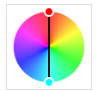
  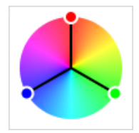
  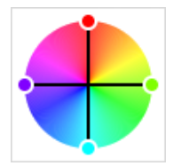
  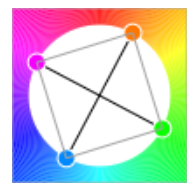
</p>

## Features

- **7 harmony modes:** complementary, analogous, monochromatic, split complementary, triadic, square and simple.
- **Drag or click** anywhere on the wheel to move the base hue.
- **Saturation and brightness** control for the whole set.
- **Harmony polygon** joins the selected colours, with its own colour and thickness.
- **Styling props** for wheel thickness, handle dots, centre dot, border and background.
- **Light.** There are no runtime dependencies, and it works with React 18 and 19.

## Installation

```bash
npm install @studiotoolkit/color-wheel
# or
pnpm add @studiotoolkit/color-wheel
# or
yarn add @studiotoolkit/color-wheel
```

## Quick start

```tsx
import { ColorWheel } from '@studiotoolkit/color-wheel';
import '@studiotoolkit/color-wheel/style.css';

export default function App() {
  return <ColorWheel harmonyMode="triadic" onColorsChange={(palette) => console.log(palette)} />;
}
```

`onColorsChange` is called with the colours, keyed by harmony mode, whenever they change:

```json
{ "split": ["#00b1ff", "#ff0031", "#ffce00"] }
```

## Harmony modes

<table>
<tr>
<td align="center"><br/><code>complementary</code></td>
<td align="center">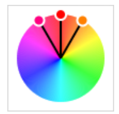<br/><code>analogous</code></td>
<td align="center">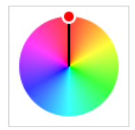<br/><code>monochromatic</code></td>
<td align="center">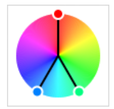<br/><code>split</code></td>
</tr>
<tr>
<td align="center"><br/><code>triadic</code></td>
<td align="center"><br/><code>square</code></td>
<td align="center">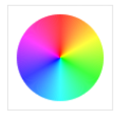<br/><code>simple</code></td>
<td></td>
</tr>
</table>

| Mode            | Hues (degrees from the base)                  |
| --------------- | --------------------------------------------- |
| `complementary` | 0, 180                                        |
| `analogous`     | −30, 0, +30                                   |
| `monochromatic` | 0, at several lightness steps                 |
| `split`         | 0, 150, 210 (the default)                     |
| `triadic`       | 0, 120, 240                                   |
| `square`        | 0, 90, 180, 270                               |
| `simple`        | 0 only                                        |

## Customisation

<table>
<tr>
<td align="center">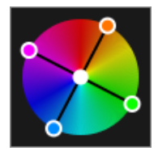<br/>Background</td>
<td align="center">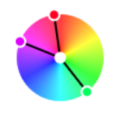<br/>Centre dot</td>
<td align="center"><br/>Harmony polygon</td>
<td align="center">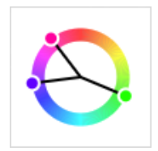<br/>Wheel thickness</td>
<td align="center">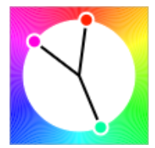<br/>Thinner wheel</td>
</tr>
</table>

```tsx
<ColorWheel
  harmonyMode="triadic"
  saturation={100}
  brightness={50}
  width={400}
  height={400}
  wheelThickness={80}
  dotSize={5}
  dotPosition="outer"
  handleThickness={2}
  handleColor="#000000"
  harmonyPolygon
  polygonColor="#000000"
  polygonThickness={1}
  showCenterDot
  centerDot="#ffffff"
  borderColor="#ffffff"
  canvasBackgroundColor="transparent"
  onColorsChange={setPalette}
/>
```

## Props

Every prop is optional.

| Prop                    | Type                                         | Default         | Description                                           |
| ----------------------- | -------------------------------------------- | --------------- | ----------------------------------------------------- |
| `harmonyMode`           | `HarmonyMode`                                | `"split"`       | See [Harmony modes](#harmony-modes).                  |
| `saturation`            | `number`                                     | `100`           | Saturation of the output colours, 0–100.              |
| `brightness`            | `number`                                     | `50`            | Lightness of the output colours, 0–100.               |
| `width`                 | `number`                                     | `450`           | Canvas width in pixels.                               |
| `height`                | `number`                                     | `450`           | Canvas height in pixels.                              |
| `circleRadius`          | `number`                                     | auto            | Wheel radius. By default it fits the canvas.          |
| `wheelThickness`        | `number`                                     | `80`            | Width of the colour ring in pixels.                   |
| `dotSize`               | `number`                                     | `5`             | Radius of the handle dots.                            |
| `dotPosition`           | `"center" \| "inner" \| "outer"`             | `"outer"`       | Where the dots sit across the ring.                   |
| `handleThickness`       | `number`                                     | `2`             | Width of the handle lines.                            |
| `handleColor`           | `string`                                     | `"#000000"`     | Handle line colour.                                   |
| `harmonyPolygon`        | `boolean`                                    | `false`         | Join the selected colours with a polygon.             |
| `polygonColor`          | `string`                                     | `"#000000"`     | Polygon line colour.                                  |
| `polygonThickness`      | `number`                                     | `1`             | Polygon line width.                                   |
| `showCenterDot`         | `boolean`                                    | `false`         | Draw a dot in the centre of the wheel.                |
| `centerDot`             | `string`                                     | `"#ffffff"`     | Centre dot colour.                                    |
| `borderColor`           | `string`                                     | `"#ffffff"`     | Wheel border colour.                                  |
| `canvasBackgroundColor` | `string`                                     | `"transparent"` | Canvas background.                                    |
| `onColorsChange`        | `(palette: PaletteOutput) => void`           | —               | Called with `{ [mode]: string[] }` when colours change. |

The `ColorData` and `PaletteOutput` types are exported, along with an optional `ThemeProvider` / `useTheme` pair for light and dark mode.

## Works well with

Pass `onColorsChange` output straight to [`@studiotoolkit/color-palette`](https://www.npmjs.com/package/@studiotoolkit/color-palette) to display it, or to any generator in [`@studiotoolkit/color-palette-generator`](https://www.npmjs.com/package/@studiotoolkit/color-palette-generator) to expand it.

## Contributing

Issues and pull requests are welcome on [GitHub](https://github.com/studiotoolkit/studiotoolkit/issues).

## License

[MIT](./LICENSE)
